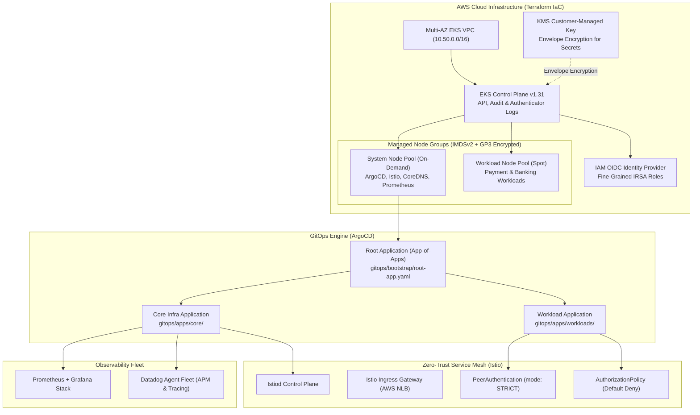
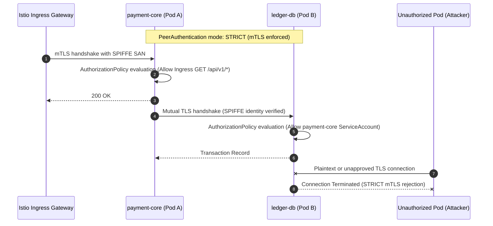
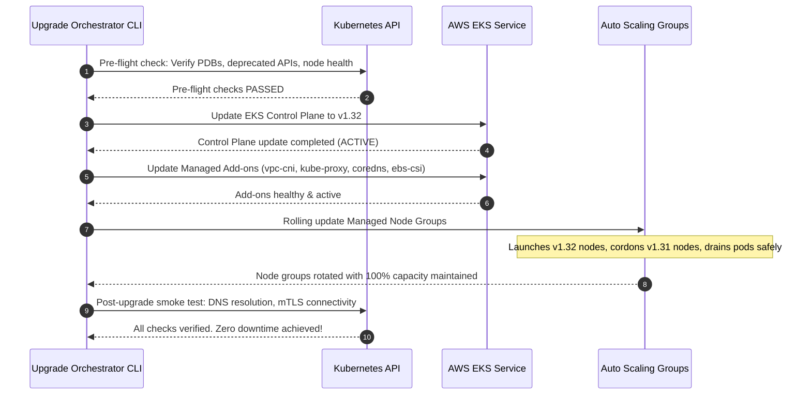

# Enterprise EKS GitOps Platform Fleet Blueprint

[](https://kubernetes.io/)
[](https://argoproj.github.io/cd/)
[](https://istio.io/)
[](https://terraform.io/)
[](LICENSE)
[](https://github.com/Bhomesh/eks-gitops-platform-blueprint/actions)

A production-grade, compliance-ready AWS EKS Fleet infrastructure blueprint implementing **declarative GitOps (ArgoCD App-of-Apps)**, **Zero-Trust Service Mesh (Istio Strict mTLS)**, **IAM Roles for Service Accounts (IRSA)**, and an **automated zero-downtime cluster version upgrade orchestrator**.

---

## 🏛 Platform Architecture



---

## 🔒 Zero-Trust Service Mesh (Istio Strict mTLS)

All east-west pod-to-pod communication is encrypted and mutually authenticated via SPIFFE/SPIRE cryptographic identities issued by Istio CA:



---

## 🔄 Zero-Downtime Cluster Version Upgrade Sequence

The blueprint provides an automated Python orchestration script (`tools/upgrade_orchestrator.py`) and detailed runbook (`docs/UPGRADE_RUNBOOK.md`) adhering to AWS best practices:



---

## 📁 Repository Layout

```
.
├── terraform/
│   ├── vpc.tf                      # Multi-AZ VPC with EKS subnets and NAT Gateways
│   ├── kms.tf                      # KMS customer key for secrets envelope encryption
│   ├── eks.tf                      # EKS v1.31 cluster with comprehensive control plane logging
│   ├── node_groups.tf              # Managed Node Groups (System On-Demand + Workload Spot)
│   ├── irsa.tf                     # IAM Roles for Service Accounts (ALB, ExternalDNS, Cert-Manager)
│   ├── variables.tf                # Configurable variables
│   ├── outputs.tf                  # Infrastructure outputs
│   └── versions.tf                 # Pinned AWS and TLS provider constraints
├── gitops/
│   ├── bootstrap/
│   │   └── root-app.yaml           # Root ArgoCD App-of-Apps manifest
│   ├── apps/
│   │   ├── core/                   # Platform infrastructure applications
│   │   └── workloads/              # Business microservice applications
│   ├── environments/
│   │   ├── base/                   # Kustomize base deployment & service
│   │   ├── dev/                    # Dev overlay (1 replica)
│   │   ├── staging/                # Staging overlay (2 replicas)
│   │   └── prod/                   # Production overlay (3-20 replicas with HPA)
│   ├── istio/
│   │   ├── base/istio-operator.yaml# IstioOperator spec with AWS NLB annotations
│   │   ├── security/               # STRICT mTLS & AuthorizationPolicy rules
│   │   └── routing/                # Canary VirtualService with 90/10 traffic shift
│   └── observability/
│       ├── prometheus-grafana/     # Production Helm values for Prometheus stack
│       ├── datadog/                # Datadog Agent Helm values (APM, logs, metrics)
│       └── dashboards/             # Pre-built Grafana JSON dashboards
├── tools/
│   └── upgrade_orchestrator.py     # Automated zero-downtime cluster upgrade CLI
├── docs/
│   └── UPGRADE_RUNBOOK.md          # Step-by-step production upgrade operational guide
├── tests/
│   └── test_upgrade_orchestrator.py# Unit test suite for upgrade safety rules
├── .github/workflows/
│   └── ci.yml                      # CI validation workflow (Terraform + Kustomize + PyTest)
├── Makefile                        # Common developer commands
└── LICENSE                         # Apache 2.0
```

---

## 🚀 Quickstart & Deployment

### 1. Provision Infrastructure via Terraform
```bash
cd terraform
terraform init
terraform plan
terraform apply
```

### 2. Configure Local Kubectl
```bash
aws eks update-kubeconfig --region us-east-1 --name bank-prod-eks
kubectl get nodes
```

### 3. Bootstrap GitOps App-of-Apps with ArgoCD
```bash
# Install ArgoCD
kubectl create namespace argocd
kubectl apply -n argocd -f https://raw.githubusercontent.com/argoproj/argo-cd/stable/manifests/install.yaml

# Apply the Root App-of-Apps
kubectl apply -f gitops/bootstrap/root-app.yaml
```

### 4. Test Zero-Downtime Cluster Upgrade in Dry-Run Mode
```bash
python3 tools/upgrade_orchestrator.py --cluster-name bank-prod-eks --target-version 1.32 --dry-run
```

---

## 📄 License
This project is licensed under the Apache 2.0 License - see the [LICENSE](LICENSE) file for details.
