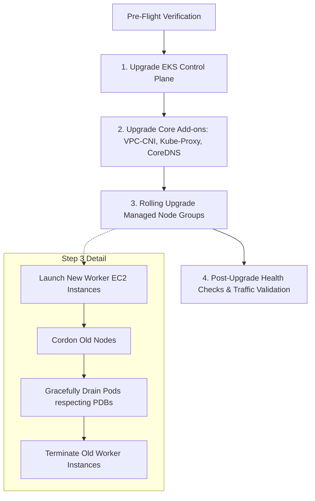

# Zero-Downtime EKS Cluster Version Upgrade Runbook

This operational runbook documents the exact procedures, order of operations, and verification gates required to perform an in-place version upgrade of the EKS Cluster Fleet (e.g., from v1.31 to v1.32) without incurring workload downtime.

---

## 🧭 Upgrade Order of Operations

Kubernetes and AWS enforce strict version skew support policies. Upgrades must follow this exact sequential progression:



---

## 📋 Phase 0: Pre-Flight Safety Checks

Execute pre-upgrade validation before modifying any cloud infrastructure:

```bash
# 1. Run automated pre-flight scan
python3 tools/upgrade_orchestrator.py --cluster-name bank-prod-eks --target-version 1.32 --dry-run

# 2. Check for PodDisruptionBudgets that block evictions
kubectl get pdb --all-namespaces

# 3. Check for deprecated API usage with kubent
which kubent >/dev/null && kubent || echo "Ensure manifest versions are updated"

# 4. Confirm all nodes are Ready
kubectl get nodes
```

---

## ⚡ Phase 1: EKS Control Plane Upgrade

Update the Kubernetes control plane version using Terraform or AWS CLI:

```bash
# Update terraform variable: cluster_version = "1.32"
terraform -chdir=terraform plan
terraform -chdir=terraform apply -target=aws_eks_cluster.this
```

*Verification:*
```bash
aws eks describe-cluster --name bank-prod-eks --query "cluster.status" --output text
# Must return: ACTIVE
```

---

## 📦 Phase 2: Core Add-ons Upgrade

Upgrade add-on components to match the target cluster version:

```bash
# 1. VPC CNI
aws eks update-addon --cluster-name bank-prod-eks --addon-name vpc-cni --addon-version v1.18.2-eksbuild.1 --resolve-conflicts OVERWRITE

# 2. Kube-Proxy
aws eks update-addon --cluster-name bank-prod-eks --addon-name kube-proxy --addon-version v1.32.0-eksbuild.1 --resolve-conflicts OVERWRITE

# 3. CoreDNS
aws eks update-addon --cluster-name bank-prod-eks --addon-name coredns --addon-version v1.11.3-eksbuild.1 --resolve-conflicts OVERWRITE

# 4. EBS CSI Driver
aws eks update-addon --cluster-name bank-prod-eks --addon-name aws-ebs-csi-driver --addon-version v1.30.0-eksbuild.1 --resolve-conflicts OVERWRITE
```

---

## 🔄 Phase 3: Managed Node Groups Rolling Upgrade

Trigger rolling node updates. AWS EKS Managed Node Groups automatically double-provision capacity before draining old nodes:

```bash
# System On-Demand Pool
aws eks update-nodegroup-version --cluster-name bank-prod-eks --nodegroup-name system-on-demand

# Workloads Spot Pool
aws eks update-nodegroup-version --cluster-name bank-prod-eks --nodegroup-name workloads-spot
```

Monitor rolling progression:
```bash
kubectl get nodes -w
```

---

## 🧪 Phase 4: Post-Upgrade Verification

1. Verify core DNS resolution:
   ```bash
   kubectl run test-dns --rm -i --tty --image=busybox -- nslookup kubernetes.default
   ```
2. Verify Istio strict mTLS mesh connectivity:
   ```bash
   istioctl authn tls-check payment-core.banking-prod.svc.cluster.local
   ```
3. Verify workload pods status:
   ```bash
   kubectl get pods -A | grep -v Running | grep -v Completed
   ```
